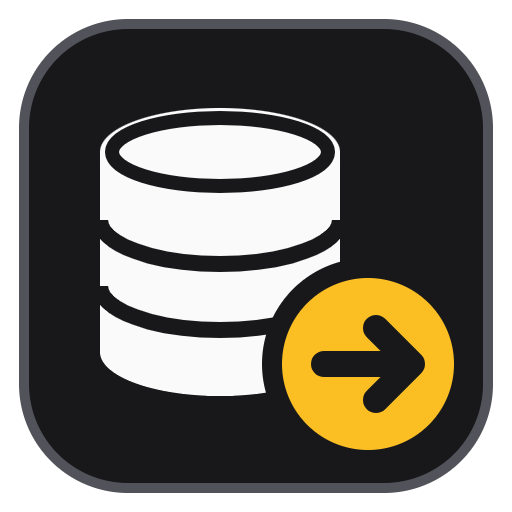

# Data Migrator

**Version 0.1.2**

Inspect legacy table files (dBASE, FoxPro, Visual FoxPro) and migrate them to MySQL, MongoDB, PostgreSQL, Microsoft SQL Server or Redis.

## Download

**[Latest Windows release →](https://github.com/furaiwave/migration/releases/latest)**

- `data-migrator-setup-<version>.exe` — installer with desktop and Start menu shortcuts.
- `data-migrator-<version>-portable.exe` — a single executable, with no installation required.

The files are unsigned, so Windows SmartScreen may display a warning on the first launch: choose **More info → Run anyway**.

## Development

For the first launch, run these commands from the repository root. You need Node.js/npm, Rust/Cargo and a C++ linker; on Windows, install MSVC Build Tools.

~~~sh
npm install
npm run install:services
npm start
~~~

After setup, `npm start` is sufficient: it first builds `native/db-connector` in release mode, then starts Vite (`http://localhost:5173`) and NestJS (`http://127.0.0.1:3000`) together with automatic restarts after changes. The initial Rust build can take longer while dependencies compile.

The Rust connector runs as a gateway child process for each request, so it does not need a separate persistent server. Restart `npm start` to pick up Rust changes. `Ctrl+C` stops both servers; if either process exits, the other stops too. You can also run the Node services separately with `npm run start:client` and `npm run start:gateway`.

| Directory | Contents |
| --- | --- |
| `client` | React/Vite interface — `npm run dev` |
| `migration-gateway` | NestJS API — `npm run start:dev` |
| `desktop` | Electron application — `npm run build`, `npm start`; installer — `npm run dist` |

To publish a new downloadable version, run `git tag v0.1.2 && git push origin v0.1.2`. GitHub Actions builds the installer and publishes the release.

## Interface language

English is the default, regardless of the browser language. The language selector retains native language names and supports Ukrainian, English, French, Spanish, Polish, Japanese, Korean, German, Swedish and Italian. Explicit selections are remembered between launches. Existing installations also start in English after this update; later selections remain persistent. Translations run locally without external services. source filenames, field names and data are never translated.

Source strings and translation keys are English. Other languages live in the translation catalog; context suffixes distinguish grammatical forms without appearing in the rendered English text.

Translation catalog: `client/src/i18n/messages.json`. Check it with `cd client` followed by `npm run test:i18n`.

Use the button next to the language selector to switch between light and dark themes. The desktop interface uses centered work areas, soft charcoal surfaces in dark mode, fine line icons, and green/red outlined actions. Your choice persists between launches; before a manual selection, the theme follows the system preference.

## MySQL synchronization

Live MySQL Sync checks existing unique indexes before writing. Every unique index must include the complete planned primary key; prefix and expression indexes do not establish that identity. An unrelated unique index could otherwise direct an upsert to a row with a different primary key, as described in the [MySQL upsert documentation](https://dev.mysql.com/doc/refman/8.4/en/insert-on-duplicate.html). Review a rejected schema or choose another import mode explicitly.

Append and Sync also compare existing column types, character sets and key collations with the plan before changing tables. Compatible wider integer, decimal, text and binary columns are accepted. Narrower types, implicit conversion of text identifiers to numbers, non-utf8mb4 character columns and different key comparison rules are rejected. Adjust the plan or destination schema to resolve a mismatch; validation does not alter an existing schema automatically.

Generated MySQL scripts enable `STRICT_ALL_TABLES` for their session and restore the previous SQL mode on completion. Metadata and warnings remain line comments in SQL and mongosh exports, including when an uploaded field name contains CR, LF or Unicode line separators.

FoxPro and dBASE 7 timestamps retain milliseconds; MySQL uses `DATETIME(3)` by default. A narrower temporal override is rejected when it would discard nonzero fractional seconds. Valid dates before year 1000 remain available to other engines, while the MySQL plan reports its destination range restriction. Binary fields preserve zero bytes, empty byte sequences and explicit NULL as distinct values across all five destinations.

## PostgreSQL and Microsoft SQL Server

Select PostgreSQL or MSSQL in **Export to**. Enter the host, port (5432 / 1433), user, password and an **existing** database, then test the connection and review the plan. The import uses the public / dbo schemas and password authentication. TLS is enabled; you can explicitly trust a self-signed server certificate for a local server.

Supported modes are append rows and replace tables. The entire import runs in one transaction; an error or cancellation before commit rolls back the changes. If the connection is lost while confirming commit, the job reports an uncertain outcome: check the database before retrying. Dependencies outside the selected tables are not removed with CASCADE. Supported values include text, exact decimals, dates, booleans, binary data and memo fields. Deleted records can be written into separate tables, and verified foreign keys can be created. MSSQL decimal precision overflow and zero bytes in PostgreSQL text are rejected before tables are changed.

Sync and SQL dump export are not yet supported for these two engines. CDX candidate keys are migrated; secondary indexes based on FoxPro expressions are not, and the plan reports this. Progress and results appear in the console. The last 2000 log entries are stored locally and can be downloaded with the .log button.

Drivers: [node-postgres](https://node-postgres.com/features/queries) and [node-mssql](https://github.com/tediousjs/node-mssql). Values use bound parameters, and passwords are not logged.

## Rust database discovery and connection checks

The **Server for a future import** panel is available before source upload. Click **Find database servers**, select a discovered server and choose **Use for import**. The database engine, address and port are copied into the import form; the selection is saved without a password. Changes to an open import form's address are deferred until the current import finishes.

The Rust module at native/db-connector searches Windows services, the SQL Server registry, processes and local ports, and performs connection checks initiated from the interface. MySQL/MariaDB, MongoDB, PostgreSQL, MSSQL and Redis are supported. A discovered port does not prove successful authentication: enter credentials and test the connection. Data transfer remains in the existing import services.

Development requires Rust/Cargo and a system C++ linker (MSVC Build Tools on Windows). Build with `cargo build --release --locked --manifest-path native/db-connector/Cargo.toml`. The desktop build packages the connector automatically; end users do not need Rust installed. See [native/db-connector/README.md](native/db-connector/README.md).

DNS/TCP diagnostics, database catalogs and connection timing are documented in [RUST_FEATURES.md](RUST_FEATURES.md).

## Workspace

The homepage offers Table files, Between databases and Version upgrade. A persistent navigation bar opens each workflow directly, along with SQL editor and SQL dump inspection. Page links use `?view=home`, `?view=files`, `?view=transfer`, `?view=upgrade`, `?view=editor` and `?view=dump`; browser Back/Forward and reload keep the selected screen. Navigation preserves connection edits in memory, with passwords cleared on reload. Active imports and migrations keep navigation locked until they finish or stop.

File-based imports have four steps: optional server selection, table files, relationship review and transfer. The overview shows table, record and active relationship counts. Technical file headers can be expanded separately. The activity log is always available in the bottom panel, where it can be expanded, filtered by status and downloaded as .log. While a file import is starting or running, New session and source switching stay disabled so the active job keeps its session and progress. After a successful start response, reloading restores the existing job, progress and cancellation for all five destinations without starting another import. Only session, engine and job IDs are saved locally. Temporary status failures keep the session locked and retry; a missing job clears its reference and asks you to check the destination before restarting. Graceful application shutdown waits for in-flight operations and SQL rollback; writes already completed in MySQL, MongoDB or Redis remain in place.

Relationship cards keep source/target tables and fields together, with full names wrapping on narrow screens. Name matches use a bidirectional marker; directed suggestions use an arrow. Search and filters narrow the list by table, kind or active state, with 50 relationships per page. Disabled links remain readable. Relationship updates run one at a time, and failed manual additions retain their selected endpoints for retry. The export plan still validates references before creating constraints.

Connected database forms include a **View structure** tree for the selected database: schemas, tables/views or collections, and reported column types. It supports search, expand/collapse, keyboard navigation, refresh and metadata JSON download. It is available for both endpoints in **Between databases** and for destination inspection during file imports. See [RUST_FEATURES.md](RUST_FEATURES.md).

## Docker / VPS

Cloud web mode, HTTPS, password authentication and persistent session storage are documented in [DEPLOYMENT.md](DEPLOYMENT.md). Startup configuration is in Dockerfile, compose.yaml and .env.example. One instance is intended for an owner or trusted team; Rust discovery and database connections run on the server.

## Redis

source imports use hashes and support key prefixes, new-record or field-update modes, TTL, deleted records, progress and cancellation. Connection checks run in Rust. See [REDIS_IMPORT.md](REDIS_IMPORT.md) for the data format and limitations.

## Between databases

Open **Between databases** from the homepage or navigation bar. It supports MySQL/MariaDB, MongoDB, PostgreSQL, MSSQL and Redis as both sources and destinations, with object selection, plan review, progress and cancellation. **Version upgrade** copies data from an older server to an already installed newer server of the same family, with detected versions and checks before writing. Data representations and limitations are documented in [MIGRATIONS.md](MIGRATIONS.md).

## GraphQL

**POST /dbf/graphql** supports connection checks, source catalogs, migration planning, start, status and cancellation across the existing database engines. It shares plans and jobs with REST, including version upgrades. Schema: **GET /dbf/graphql/schema**. Usage, authentication and examples: [GRAPHQL.md](GRAPHQL.md).
## SQL dump inspection

Choose **SQL dump** in the navigation bar to open a UTF-8 plain-text PostgreSQL, MySQL or SQLite dump (up to 50 MB). The browser reads CREATE TABLE, ALTER TABLE ADD and DROP TABLE statements without executing SQL or uploading the file. Choose a format explicitly when a SQL file has no recognizable dump header; changing the format rereads the selected file. Table cards show columns and primary/foreign keys; selecting a table filters incoming and outgoing relationships, including composite keys. Only declared foreign keys are shown. Referenced tables missing from the dump are marked. Data-only dumps, compressed files and PostgreSQL custom archives must first be exported as plain-text SQL with schema.

## SQL editor

Choose **SQL editor** in the navigation bar for native PostgreSQL, MySQL/MariaDB and SQL Server queries. It includes SQL completion, query tabs, a table explorer, Ctrl+Enter, result filtering/sorting, cell inspection and CSV/JSON export. Rust streams bounded results; the TypeScript grid virtualizes rows and columns. See [SQL_EDITOR.md](SQL_EDITOR.md) for execution semantics, limits and checks.
